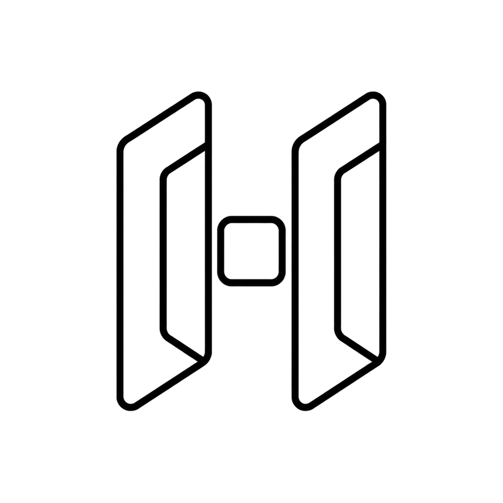
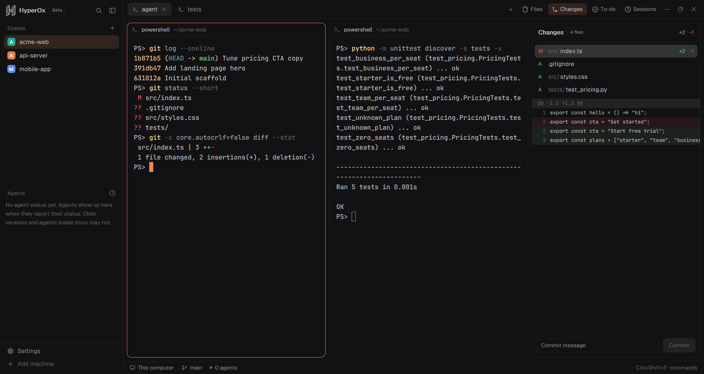
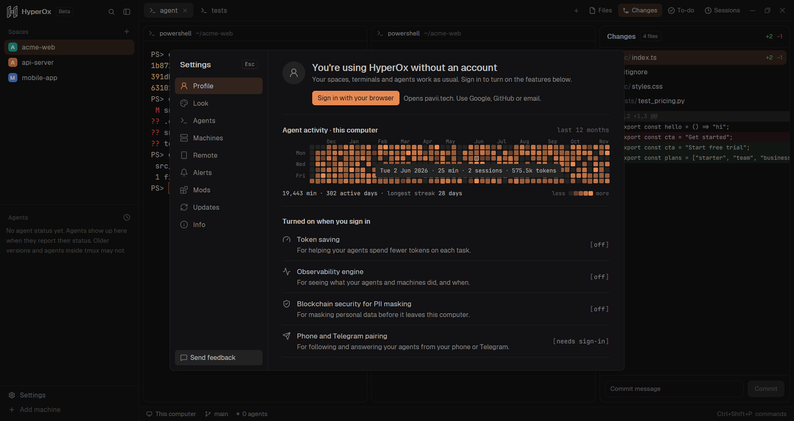
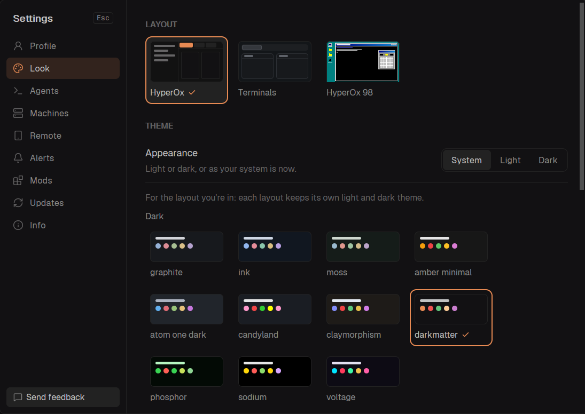
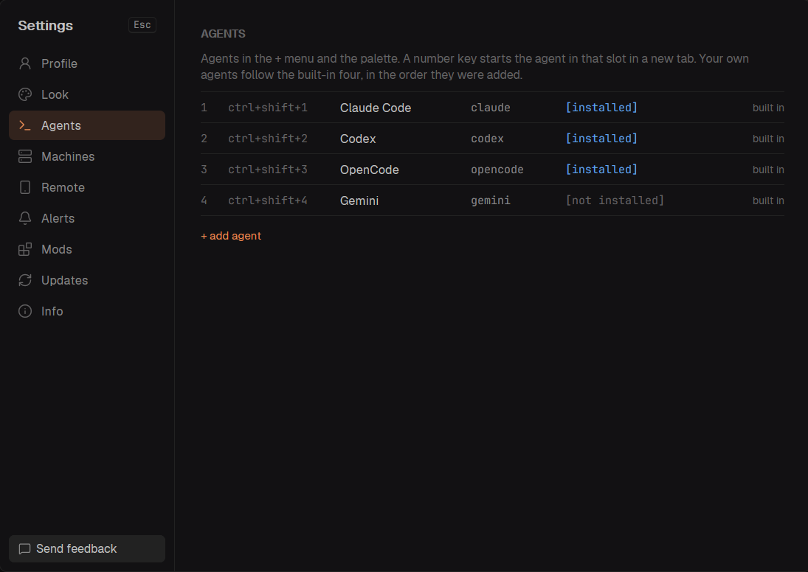

<p align="center">
  
</p>

<h1 align="center">HyperOx</h1>

<p align="center">
  <b>The desktop workspace for AI coding agents.</b><br>
  Run Claude Code, Codex, OpenCode, Gemini CLI and your own tools side by side, see what every agent is doing, and stay in control from your desk or your phone.
</p>

<p align="center">
  <a href="https://github.com/buckleson/h0x-ADE-Releases/releases/latest/download/h0x-ade-windows-x86_64.tar.gz"></a>
  <a href="https://github.com/buckleson/h0x-ADE-Releases/releases/latest/download/h0x-ade-macos-aarch64.tar.gz"></a>
  <a href="https://github.com/buckleson/h0x-ADE-Releases/releases/latest/download/h0x-ade-linux-x86_64.tar.gz"></a>
  <a href="https://github.com/buckleson/h0x-ADE-Releases/releases/latest/download/h0x-ade-linux-aarch64.tar.gz"></a>
</p>

<p align="center">
  <a href="https://pavii.tech/products/dev-tools/docs/"><b>Documentation</b></a> ·
  <a href="https://github.com/buckleson/h0x-ADE-Releases/releases"><b>Releases</b></a> ·
  <a href="https://pavii.tech"><b>Pavii</b></a> ·
  <a href="https://buckleson.com"><b>Buckleson</b></a> ·
  <a href="#build-from-source"><b>Build from source</b></a>
</p>

<p align="center">
  
</p>

---

## About

HyperOx is a desktop app for terminals and coding agents. Terminals keep running when you close the window: they live in the h0x-core runtime, a small background program, and are back where you left them when you open the window again. HyperOx is in Beta: expect rough edges and breaking changes between releases.

## Works with

<p align="center">
  
  
  
  
  
</p>

Each agent runs in a normal terminal, so anything you can start from a shell works. HyperOx also recognizes other agent CLIs (for example Cursor, Copilot, Amp, Kiro and Kimi) and shows their state.

## What you get

| Feature | What it does |
|---|---|
| Spaces, tabs and split panes | A space holds a project, tabs hold the agents and shells you run in it, panes split a tab. |
| Run any agent | Start Claude Code, Codex, OpenCode, Gemini CLI or your own program in a new tab with one shortcut. |
| Agents panel | Every agent with its state (working, blocked on you, done, idle). Pin the ones you care about, peek without switching tabs. |
| Files, Changes, To-do, Sessions | Edit files with autosave, review the git diff and commit, keep to-do lists, and reopen earlier sessions. |
| Remote machines | Connect over SSH and run agents on a server. They keep running while your laptop sleeps. |
| Phone and Telegram pairing | Pair an account to see your agents, get a notice when one finishes, and answer permission prompts away from your desk. |
| Activity graph | A calendar of your work with agents. It is computed and stored on your computer only. |
| Themes and layouts | Themes such as darkmatter, Sodium, Voltage and Phosphor, plus switchable layouts you can clone and change. |
| Mods | Small JavaScript programs that add panels, overlays and windows. Scriptable UI. |
| Signed releases and in-app updates | Every file is signed and checked before it installs. A bad update rolls back by itself. |
| Workspaces (0.1.34, coming with the next release) | Save the space you are in (tabs, panes, folders and running agents) and bring it back later. Up to 5 saved. |

### With an account

Signing in adds features that run through the HyperOx account:

| Feature | What it does |
|---|---|
| Token saving | Prompt caching to cut the tokens your agents spend. |
| Observability | Logs, traces and evals for your agent runs. |
| PII masking | Blockchain-backed masking of personal data. |

The full app is in beta and invite-only. See the [documentation](https://pavii.tech/products/dev-tools/docs/) for how to get access.

## Screenshots

<table>
  <tr>
    <td width="50%"><br><sub>Activity graph. Stays on your computer.</sub></td>
    <td width="50%"><br><sub>Themes and layouts.</sub></td>
  </tr>
  <tr>
    <td width="50%"><br><sub>Settings → Agents: add your own agents and CLI tools.</sub></td>
    <td width="50%"><br><sub>Spaces, tabs and panes in the main window.</sub></td>
  </tr>
</table>

## Keyboard shortcuts

Windows and Linux first, macOS second. Every key can be rebound in `keys.json` in the app folder.

| Action | Windows / Linux | macOS |
|---|---|---|
| Start an agent in a new tab (1 Claude Code, 2 Codex, 3 OpenCode, 4 Gemini CLI, 5-9 your own) | `Ctrl+Shift+1` ... `9` | `Ctrl+Shift+1` ... `9` |
| Command palette | `Ctrl+Shift+P` | `Cmd+Shift+P` |
| New tab / close tab | `Ctrl+Shift+T` / `Ctrl+Shift+W` | `Cmd+T` / `Cmd+W` |
| New space | `Ctrl+Shift+N` | `Cmd+N` |
| Go to tab 1-9 | `Ctrl+1` ... `9` | `Cmd+1` ... `9` |
| Next / previous tab | `Ctrl+Tab` / `Ctrl+Shift+Tab` | `Ctrl+Tab` / `Ctrl+Shift+Tab` |
| Go to space 1-9 | `Alt+1` ... `9` | `Ctrl+1` ... `9` |
| Split pane right / down | `Ctrl+Shift+O` / `Ctrl+Shift+E` | `Cmd+D` / `Cmd+Shift+D` |
| Move between panes | `Alt+Arrow` (or `Alt+H J K L`) | `Cmd+Alt+Arrow` |
| Zoom pane | `Ctrl+Shift+Z` | `Cmd+Shift+Enter` |
| Close pane | `Ctrl+Shift+X` | `Cmd+Shift+W` |
| Find in terminal | `Ctrl+Shift+F` | `Cmd+F` |
| To-do panel | `Ctrl+Shift+J` | `Cmd+Shift+J` |
| Show or hide the sidebar | `Ctrl+Shift+B` | `Cmd+B` |
| Settings | `Ctrl+,` | `Cmd+,` |
| Open a file named in a terminal, at its line | `Ctrl+click` | `Cmd+click` |
| Close Settings and dialogs | `Esc` | `Esc` |

## Install

| Platform | Command |
|---|---|
| macOS and Linux | `curl -fsSL https://github.com/vjk7989/h0x-ADE-app/releases/latest/download/install.sh \| sh` |
| Windows (PowerShell) | `powershell -c "irm https://github.com/vjk7989/h0x-ADE-app/releases/latest/download/install.ps1 \| iex"` |
| Manual | Download the `.tar.gz` for your platform from the buttons above or the [releases page](https://github.com/buckleson/h0x-ADE-Releases/releases), [verify it](#verify-your-download), unpack it and run `h0x-ade`. |

Requirements: Windows 10/11 x64, macOS on Apple Silicon, Linux x86_64 or aarch64.

On macOS, if the system blocks the app, sign it locally once:

```sh
xattr -dr com.apple.quarantine ~/Applications/HyperOx.app && codesign --force --deep --sign - ~/Applications/HyperOx.app
```

## Verify your download

Every release file has a [minisign](https://jedisct1.github.io/minisign/) signature next to it (`<file>.minisig`). The public key is:

```text
RWTEdqtOBn6VKQ/x9x3qWk/gIWUb/I1OlZXsTlHyrkp9Yq30qBki+tdt
```

```sh
minisign -Vm h0x-ade-linux-x86_64.tar.gz -P RWTEdqtOBn6VKQ/x9x3qWk/gIWUb/I1OlZXsTlHyrkp9Yq30qBki+tdt
```

[rsign2](https://github.com/jedisct1/rsign2) works the same way. The installers and the in-app updater check these signatures themselves.

## FAQ

**Is it free?** HyperOx is in early access (beta). The full app is invite-only; see the [documentation](https://pavii.tech/products/dev-tools/docs/).

**Where is my data?** Your activity graph is computed and kept on your computer. Terminals and files stay on the machines they run on.

**Do my agents stop when I close the window?** No. The engine keeps terminals running in the background and they are there when you open the app again.

## Installer notes

### Linux and macOS

```sh
curl -fsSL https://github.com/vjk7989/h0x-ADE-app/releases/latest/download/install.sh | sh
```

Linux needs a desktop session and a Vulkan-capable GPU driver; `h0x-ade` goes into `~/.local/bin`, so make sure that is on your PATH. macOS builds are for Apple Silicon; the installer puts `HyperOx.app` in `~/Applications`.

### Windows

```powershell
irm https://github.com/vjk7989/h0x-ADE-app/releases/latest/download/install.ps1 | iex
```

The app lands in `%LOCALAPPDATA%\Programs\h0x-ade` and is added to your PATH. No admin needed; open a new terminal afterwards.

On every platform the installer also installs `h0x-core`, the runtime that runs your terminals, if there is none yet. The app's own files live in `~/.config/h0x-ade`.

### Manual download

Pick the file for your platform from the [latest release](https://github.com/vjk7989/h0x-ADE-app/releases/latest):

| Platform | Asset |
|---|---|
| Linux x86_64 / aarch64 | `h0x-ade-linux-x86_64.tar.gz` / `h0x-ade-linux-aarch64.tar.gz` |
| macOS Apple Silicon | `h0x-ade-macos-aarch64.tar.gz` |
| Windows x86_64 | `h0x-ade-windows-x86_64.tar.gz` |

Prefer the installers: they also place the launcher, menu entry and `h0x-core`.

## Get started

Run `h0x-ade` (or open HyperOx from the Start menu or Applications folder). The app installs `h0x-core` on first run if it is missing. Add a space for a project folder, then open a tab and start your agent or a shell in it.

## Find your work

- **Spaces** are projects: a folder, on this machine or another one. Switch between them in the sidebar.
- **Tabs** inside a space are the things you have running there: an agent, a shell, a dev server. Name them.
- **Panes** split a tab. Open a terminal beside the agent that is working for you.

The agents sidebar lists every agent with its state: **Working**, **Blocked** (it is waiting on you), **Done** (it finished while you were elsewhere) or **Idle**. Blocked and Done play a sound and show a toast; peek at an agent without leaving your current tab, or jump straight to it.

Every terminal has a short address, `t7` for one on this machine and `vps/t7` for one on a machine called `vps`. Agents and scripts use these addresses to talk to each other through `h0x-core`.

## Edit files

Open a file from the **Files** panel and type: it saves itself a second after you stop, and right away when you switch files, close the panel or press `Ctrl+S` (`Cmd+S` on macOS). A dot before the name means there are unsaved edits. Line endings stay as the file had them.

If an agent changes the file while you have unsaved edits, HyperOx stops saving that file and asks: **Reload** takes the version on disk, **Keep mine** writes yours over it. A file you have not touched just reloads.

After you save, idle agents in the same space get a one-line note naming the files you edited, so they re-read them before changing anything. Busy agents get it once they are idle. Files on another machine open read-only for now.

## To-do lists

Open **To-do** next to Files and Changes, or press `Ctrl+Shift+J` (`Cmd+Shift+J` on macOS): several lists, tasks with steps, `Space` to tick. They are Markdown files in the app's folder, the same in every space. See [docs/todo.md](docs/todo.md).

## Work on another machine

Open **Settings → Machines** and pick a host from your SSH config. HyperOx connects over SSH, installs `h0x-core` there if it is missing, and lists that machine in the sidebar with its own spaces. Agents on a server keep running while your laptop sleeps.

## Make it yours

- **Command palette**: `Ctrl+Shift+P` (`Cmd+Shift+P` on macOS) lists every command with its arguments.
- **Settings**: look, sounds, machines, updates, info, and the raw `settings.json` in your app home.
- **Layouts**: HyperOx (the default), Terminals (just terminals), and HyperOx 98 (a whole desktop in one mod). Clone one and change anything.
- **Mods** are small JavaScript programs that draw panels, overlays and windows. The shipped ones are examples; your agent can write new ones. `AGENTS.md` in your app home is the guide, written for agents and people alike.
- **Keys**: `keys.json` in your app home rebinds anything; see [the keys section](defaults/AGENTS.md#keys-keysjson) of the mod guide for the format, including JSON objects for named, typed command arguments.

## Updates and privacy

Installed releases check GitHub Releases for new versions and tell you in the corner; the app switches on quit, and `h0x-core` updates without stopping your terminals. Source builds do not update themselves.

During the beta, release builds send usage analytics, scrubbed of paths and long text; turn them off in Settings > Info. Failure reports are always sent. Apart from that, HyperOx only goes online for update checks, network requests made by mods you install, and feedback you review before sending. See [security and privacy](docs/security.md).

## For agents

An agent working inside HyperOx can drive the window from a shell:

```sh
h0x-ade --skill      # the manual: how to inspect and change the window
h0x-ade ls           # spaces, their tabs and terminals, including pane IDs
h0x-ade status       # what is on screen, and any errors
h0x-ade commands     # every command, its arguments, what it does
h0x-ade do tab.new --name "fix login" --argv '["claude"]'
```

Starting, reading and waiting on terminals is `h0x-core`'s job: `h0x-core --skill` prints its manual.

## Remote control

`h0x-core` can let a paired chat account see and drive your terminals while you are away. See [Remote control (bridge)](https://github.com/vjk7989/h0x-ADE-core/blob/main/docs/bridge.md).

## Build from source

Rust 1.95 and Zig 0.17.0 (for cross builds and the C dependencies).

```sh
git clone --recurse-submodules https://github.com/vjk7989/h0x-ADE-app
cd h0x-ADE-app
cargo build --locked
cargo test --locked
```

The app needs a running `h0x-core` of the matching generation; `distribution/core-version` names the release it expects. Mods are plain files under `defaults/`: edit, save, and the running window reloads them.

## Part of HyperOx

- [h0x-core](https://github.com/vjk7989/h0x-ADE-core): the runtime that runs terminals and agents and keeps them alive.
- [h0x](https://github.com/vjk7989/h0x-ADE-Runtime): the terminal multiplexer, for the same terminals inside a TUI.
- This repository: the desktop app.

## License

Apache-2.0. See [LICENSE](LICENSE) and [NOTICE](NOTICE) for attributions.

<p align="center">Made by <a href="https://pavii.tech">Team Pavii</a> · Security partner <a href="https://buckleson.com">Buckleson</a></p>
